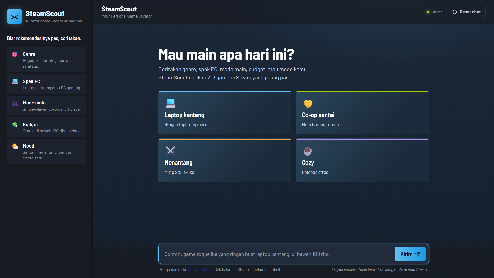
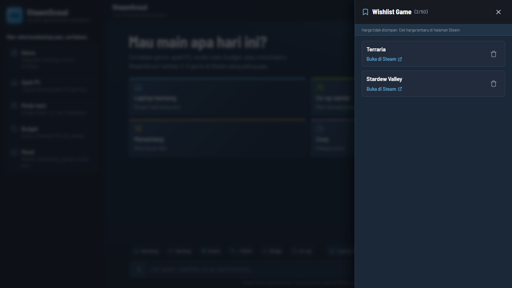
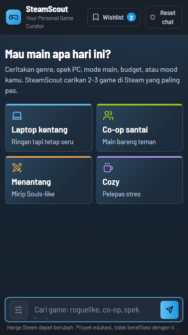
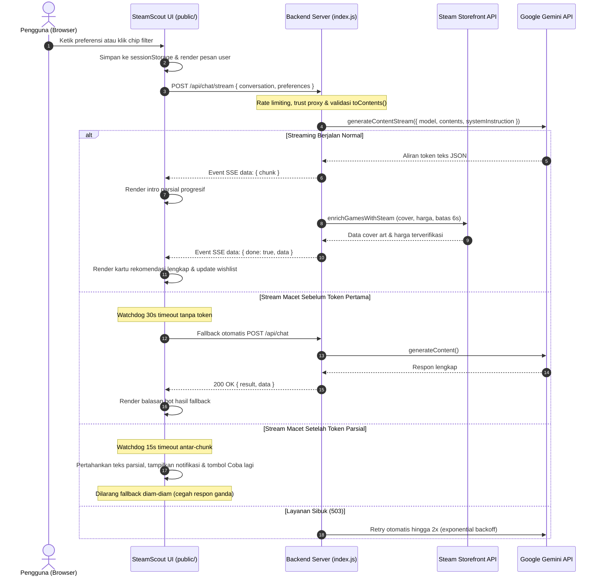

# SteamScout: Your Personal Game Curator

[](https://github.com/Farhanrhm/ChatBot/actions/workflows/ci.yml)
[](https://chat-bot-three-gold.vercel.app/)

SteamScout adalah aplikasi web chatbot rekomendasi game PC di ekosistem Steam. Menggunakan persona kurator game berbahasa Indonesia santai khas gamer, SteamScout membantu pemain menemukan 2-3 game yang relevan berdasarkan genre, spesifikasi perangkat (laptop kentang atau PC gaming), mode bermain (single-player atau co-op), budget, dan suasana hati.

---

## Antarmuka Aplikasi

### 1. Tampilan Utama Desktop

*Navigasi sidebar, status koneksi, percakapan rekomendasi game terstruktur, dan toolbar filter preferensi.*

### 2. Drawer Modal Wishlist

*Panel drawer wishlist tersimpan dengan focus trap keyboard, navigasi tautan toko Steam, dan tombol hapus.*

### 3. Tampilan Responsif Ponsel (Mobile)

*Tata letak responsif pada viewport layar ponsel dengan target sentuh optimal dan navigasi anti-scroll.*

---

## Fitur Utama

1. **Persona Kurator Steam Khusus**: Memberikan rekomendasi terstruktur (Judul, Genre/Tag, Alasan Cocok, Spek & Budget) dengan batas maksimal 2-3 game per balasan agar tidak membebani pengguna. Tombol aksi mengarahkan langsung: "Buka di Steam Store" untuk game yang terverifikasi di katalog Steam, dan "Cari di Steam" untuk judul yang belum terverifikasi.
2. **Filter Preferensi Cepat (Quick Filter Bar)**: Toolbar horizontal di atas area composer (Spek: Kentang / Gaming, Budget: Gratis / < 100rb, Mode: Single / Co-op) yang dapat disembunyikan atau ditampilkan sewaktu-waktu. Preferensi dikirim terpisah melalui field `preferences`, divalidasi server, dan dirakit ke catatan permintaan tanpa merusak riwayat percakapan.
3. **Memori Percakapan Bertingkat (Multi-turn)**: Mengingat konteks dan preferensi pengguna selama sesi obrolan berlangsung (hingga 20 turn terakhir) dengan perlindungan payload aman.
4. **Kartu dan Chip Saran Cepat (Quick Prompts)**: Tombol interaktif untuk memulai pencarian instan seperti Laptop kentang, Co-op santai, Menantang (Souls-like), dan Cozy.
5. **Desain Steam Dark Theme & Layout Terkunci**: Palet warna autentik ekosistem Steam (`#171a21`, `#1b2838`, aksen cyan `#66c0f4`) dengan tipografi Barlow. Tata letak terkunci rapi pada viewport (0px page scroll overflow) dan kartu game tersusun rapi secara horizontal pada layar desktop.
6. **Peningkatan Aksesibilitas**: Meraih skor Lighthouse Accessibility 100/100 (audit otomatis). Dilengkapi target sentuh tombol minimal 44x44px, navigasi keyboard lengkap dengan indikator visual `:focus-visible`, sinkronisasi atribut `aria-pressed`, region live tersembunyi (`#live-announcer`) untuk pembaca layar, dan preferensi `prefers-reduced-motion`.
7. **Wishlist Lokal Tanpa Duplikasi**: Menyimpan game favorit langsung dari kartu obrolan ke browser storage (maksimal 50 game). Menerapkan deduplikasi ketat (`isSameGame` yang membedakan game berbeda ber-App ID berbeda), auto-upgrade entri tanpa App ID saat ditemukan rekomendasi resmi, proteksi anti-downgrade, sinkronisasi instan antar-tab pada peramban yang sama, modal drawer dengan focus trap (`Tab`, `Shift+Tab`, `Esc`), serta kebal terhadap data storage rusak.
8. **Ketahanan Streaming AI (Watchdog Resilient)**: Streaming Server-Sent Events (`/api/chat/stream`) dilindungi oleh dual-timer watchdog (batas 30 detik untuk chunk pertama dan 15 detik antar-chunk). Jika stream macet sebelum token pertama tampil, klien otomatis fallback ke `POST /api/chat`. Jika terputus setelah teks parsial tampil, teks dipertahankan di layar dan ditampilkan kotak notifikasi ramah beserta tombol "Coba lagi" (tanpa fallback diam-diam dan tanpa menduplikasi pesan pengguna).
9. **Deteksi Mode Offline Reaktif**: Memeriksa status koneksi secara otomatis dan mendengarkan event jaringan. Saat offline, tombol Kirim dan chip dinonaktifkan (`aria-disabled="true"`), banner status overlay ditampilkan tanpa merusak tata letak, dan teks yang sedang diketik pengguna di textarea tetap aman tersimpan.
10. **Storefront Grounding & Cache App ID**: Verifikasi otomatis ke endpoint Steam Storefront untuk menyajikan cover art resmi, status harga aktual (diskon, Free to Play, Segera Hadir), serta cache ringan App ID di sisi peramban untuk mempercepat resolusi tautan toko resmi.

---

## Teknologi yang Digunakan

- **Backend**: Node.js, Express.js (ES Modules)
- **AI SDK**: `@google/genai` (Google Gemini API, model `gemini-3.1-flash-lite`)
- **Keamanan & Middleware**: `helmet`, `express-rate-limit`, `dotenv`
- **Frontend**: Vanilla HTML5, Vanilla CSS3 (CSS Variables, Flexbox, CSS Grid), Vanilla JavaScript (tanpa framework, tanpa build step)
- **Testing**: Node.js built-in test runner (`node:test`, `node:assert`), Puppeteer Core (`puppeteer-core`) untuk pengujian layout dan perilaku headless browser
- **CI/CD**: GitHub Actions (otomatisasi pengujian `npm test`, `test:layout`, dan `test:behavior` pada event `push` dan `pull_request` ke branch `main`)

---

## Arsitektur & Kontrak API

### Diagram Alur Komunikasi



### Kontrak Endpoint API Ringkas

| Method | Endpoint | Deskripsi |
|---|---|---|
| `POST` | `/api/chat` | Endpoint percakapan utama non-streaming dan jalur fallback otomatis saat stream macet |
| `POST` | `/api/chat/stream` | Endpoint rekomendasi streaming real-time via Server-Sent Events (SSE) |
| `GET` | `/api/health` | Pemeriksaan kesehatan server (mengembalikan `{ "status": "ok" }`) |

#### Format Request Body (`POST /api/chat` & `POST /api/chat/stream`)

```json
{
  "conversation": [
    { "role": "user", "text": "Game co-op santai untuk laptop kentang" }
  ],
  "preferences": {
    "spec": "potato",
    "budget": "free",
    "mode": "coop"
  }
}
```

- **Nilai Sah Field `preferences` (Opsional)**:
  - `spec`: `"any"` | `"potato"` (laptop kentang) | `"gaming"` (PC gaming)
  - `budget`: `"any"` | `"free"` (gratis / F2P) | `"under100k"` (di bawah Rp100 ribu)
  - `mode`: `"any"` | `"single"` (single-player) | `"coop"` (co-op / mabar)
- **Format Respon Error**: Objek JSON `{ "error": "Pesan deskripsi kesalahan" }` dengan kode status HTTP yang relevan (`400` untuk input salah, `413` untuk payload melebihi 100kb, `429` untuk batas laju request, `503` jika layanan AI sibuk, atau `504` untuk timeout).

---

## Struktur Direktori

```text
final_project/
├── .github/
│   └── workflows/
│       └── ci.yml            # Otomatisasi pipeline CI via GitHub Actions (unit test, layout, behavior)
├── .env.example              # Template variabel lingkungan
├── .gitignore                # Konfigurasi pengabaian berkas Git
├── AGENTS.md                 # Konfigurasi panduan agen AI
├── api/
│   └── index.js              # Entrypoint serverless untuk platform cloud (Vercel)
├── docs/
│   ├── EVALUATION.md         # Laporan evaluasi rekomendasi AI
│   ├── TEST_RESULTS.md       # Matriks pengujian kualitas & skenario cURL
│   ├── lighthouse-a11y.json  # Laporan hasil audit aksesibilitas otomatis (100/100)
│   └── screenshots/          # Tangkapan layar antarmuka aplikasi
├── eval/                     # Dataset pertanyaan & skrip benchmark evaluasi AI
├── index.js                  # Server Express, middleware keamanan, rate limit & endpoint chat
├── package.json              # Dependensi dan skrip proyek
├── package-lock.json
├── prompts/
│   └── systemPrompt.js       # Definisi System Instruction kurator SteamScout
├── public/                   # Frontend statis disajikan dari satu origin
│   ├── index.html            # Struktur markup aplikasi, live announcer, dan SVG sprite
│   ├── script.js             # Logika interaktif, streaming watchdog, offline, dan manajemen UI
│   ├── style.css             # Desain Steam Dark Theme, layout anti-scroll, dan respon viewport
│   └── wishlistCore.js       # Modul inti logika wishlist lokal, deduplikasi, dan migrasi
├── scripts/
│   ├── verify-behavior.mjs   # Skrip pengujian otomatis perilaku headless browser
│   └── verify-layout.mjs     # Skrip verifikasi 0px page scroll pada 5 resolusi layar
├── services/
│   ├── dailyCap.js           # Middleware pembatasan kuota permintaan harian (per instance & per IP)
│   └── steamStore.js         # Pengayaan data cover art, harga, dan verifikasi katalog Steam
├── test/
│   ├── fixtures/             # Data tiruan respon Steam Storefront untuk pengujian
│   ├── eval-logic.test.js    # Unit test modul penilaian evaluasi
│   └── validation.test.js    # Unit test validasi input, preferensi, prompt, dan wishlist
└── vercel.json               # Konfigurasi routing serverless Vercel
```

---

## Cara Instalasi & Menjalankan

### 1. Prasyarat
- Node.js versi 20.0.0 atau lebih tinggi.
- Kunci API Google Gemini (dapat diperoleh di [Google AI Studio](https://aistudio.google.com/)).

### 2. Langkah Pemasangan
1. Kloning repositori dan masuk ke folder proyek:
   ```bash
   git clone https://github.com/Farhanrhm/ChatBot.git
   cd ChatBot
   ```
2. Pasang seluruh dependensi:
   ```bash
   npm install
   ```
3. Salin file konfigurasi lingkungan dari template:
   ```bash
   cp .env.example .env
   ```
4. Buka file `.env` dan masukkan API Key Gemini Anda:
   ```env
   GEMINI_API_KEY=your_gemini_api_key_here
   ```
5. Jalankan server dalam mode pengembangan:
   ```bash
   npm run dev
   ```
6. Buka peramban di alamat:
   ```text
   http://localhost:3000
   ```

---

## Menjalankan Pengujian

Proyek ini dilengkapi dengan rangkaian pengujian otomatis untuk memverifikasi logika backend, ketahanan tata letak antarmuka, dan perilaku interaktif peramban:

1. **Unit Test Logika & Modul Inti**:
   ```bash
   npm test
   ```
   Menjalankan unit test bawaan Node.js untuk memverifikasi validasi input `toContents()`, sanitasi data, perakitan prompt preferensi, penanganan retry 503, serta aturan deduplikasi dan auto-upgrade pada `wishlistCore.js`.
2. **Verifikasi Tata Letak & Viewport**:
   ```bash
   npm run test:layout
   ```
   Menjalankan pengujian otomatis menggunakan browser headless untuk memastikan tata letak terkunci presisi tanpa page scroll overflow (0px) pada 5 resolusi standar (desktop lebar, laptop standar, layar pendek, dan ponsel).
3. **Verifikasi Perilaku DOM & Aksesibilitas**:
   ```bash
   npm run test:behavior
   ```
   Menjalankan pengujian otomatis perilaku peramban (Puppeteer) yang mencakup sinkronisasi wishlist multi-tab, deteksi mode offline, watchdog fallback streaming, preservasi teks parsial saat koneksi terputus, focus trap pada modal drawer, dan respon screen reader live region.

> [!NOTE]
> * **Kemandirian Server Pengujian**: Skrip `npm run test:layout` dan `npm run test:behavior` menyalakan server HTTP statis mandiri secara otomatis (masing-masing pada port 3588 dan 3589). Pengujian dapat dijalankan langsung tanpa perlu menyalakan `npm run dev` terlebih dahulu.
> * **Resolusi Jalur Peramban (Chrome / Chromium)**: Skrip pengujian peramban secara otomatis mendeteksi instalasi Google Chrome atau Chromium pada path umum di Windows, macOS, dan Linux. Jika peramban terpasang di lokasi kustom atau tidak terdeteksi otomatis, tentukan lokasinya melalui variabel lingkungan `CHROME_PATH`.
>   - Windows (PowerShell): `$env:CHROME_PATH = "C:\Program Files\Google\Chrome\Application\chrome.exe"`
>   - Linux / macOS: `export CHROME_PATH="/usr/bin/google-chrome"`
> * **Lingkungan CI (GitHub Actions)**: Sesuai konfigurasi `.github/workflows/ci.yml`, seluruh pipeline pengujian (`npm test`, `npm run test:layout`, dan `npm run test:behavior`) dijalankan secara otomatis pada event `push` dan `pull_request` ke branch `main` menggunakan Google Chrome headless.

---

## Penjelasan Variabel Lingkungan (`.env`)

| Variabel | Deskripsi | Default |
|---|---|---|
| `GEMINI_API_KEY` | Kunci autentikasi Google Gemini API | *(Wajib diisi)* |
| `GEMINI_MODEL` | Nama model AI yang digunakan | `gemini-3.1-flash-lite` |
| `GEMINI_TEMPERATURE` | Tingkat kreativitas variasi jawaban AI | `0.75` |
| `PORT` | Port server lokal Express | `3000` |
| `NODE_ENV` | Mode lingkungan aplikasi (`production` / `development`) | `development` |
| `RATE_LIMIT_WINDOW_MS` | Jendela waktu rate limit (dalam milidetik) | `60000` (1 menit) |
| `RATE_LIMIT_MAX` | Maksimal request per menit per IP (in-memory per instance server) | `20` |
| `DAILY_REQUEST_CAP` | Batas maksimal total request per hari per instance server (in-memory, best-effort) | `500` |
| `DAILY_REQUEST_CAP_PER_IP` | Batas maksimal pesan per hari per alamat IP (in-memory per instance server) | `60` |
| `CHROME_PATH` | Path file eksekusi Google Chrome / Chromium untuk pengujian headless | *(Opsional untuk pengujian)* |

---

## Langkah Keamanan & Hardening

1. **Perlindungan Kredensial**: File `.env` masuk ke `.gitignore` sehingga API key tidak terunggah ke repositori publik. Server membatalkan proses startup jika API key belum dikonfigurasi saat mode produksi.
2. **Validasi Anti-Injeksi (`toContents`)**: Riwayat percakapan divalidasi ketat (maksimal 20 turn terakhir, membuang role selain `user` dan `model`, memangkas pesan user di atas 1000 karakter, dan menolak urutan percakapan ilegal).
3. **Pencegahan Denial of Service (DoS)**:
   - Pembatasan ukuran payload JSON dibatasi ke `100kb` untuk mengakomodasi riwayat multi-turn hingga 20 turn secara aman tanpa memicu error 413.
   - Penerapan `express-rate-limit` (20 request per menit per IP per instance server) dan `trust proxy` untuk mitigasi lonjakan permintaan API.
4. **Header Keamanan (Helmet)**: Menerapkan Content Security Policy (CSP) ketat yang hanya mengizinkan resource lokal serta Google Fonts resmi.
5. **Ketahanan Koneksi (Resilience)**: Panggilan Gemini dilengkapi batas timeout serta mekanisme retry otomatis 2x dengan exponential backoff jika server Google mengalami status 503.
6. **Penyajian Single Origin**: Frontend disajikan langsung dari folder `./public/` oleh server Express sehingga tidak memerlukan konfigurasi CORS tambahan yang berisiko.
7. **Graceful Shutdown**: Server Express menangani sinyal `SIGINT` dan `SIGTERM` dengan batas waktu paksa 10 detik agar koneksi tertutup bersih saat proses dihentikan.

---

## Fitur Harga & Diskon Steam (Storefront Grounding)

SteamScout memverifikasi judul rekomendasi ke API publik Steam Storefront untuk menyajikan data harga dan status game secara langsung pada kartu:

1. **Model Status Empat Keadaan**:
   - **Game Berbayar (`paid`)**: Menampilkan harga normal, serta harga awal yang dicoret dan badge diskon hijau (contoh: `-50%`) jika sedang berlangsung Steam Sale.
   - **Free to Play (`free`)**: Menampilkan label "Free to Play" hanya jika Steam mengonfirmasi status gratis (`is_free: true`).
   - **Segera Hadir (`upcoming`)**: Menampilkan label "Segera Hadir" untuk judul yang belum dirilis.
   - **Tidak Diketahui (`unknown`)**: Jika data harga tidak ada, kartu tetap tampil utuh tanpa baris harga (fallback anggun).
2. **Keandalan & Ketahanan (Resilience)**:
   - **Anggaran Waktu & Fallback**: Pengayaan data Steam dibatasi total 6 detik menggunakan `Promise.allSettled`. Gangguan koneksi atau timeout Steam tidak akan menggagalkan kurasi rekomendasi utama Gemini.
   - **Pencocokan Judul & Penolakan Sekuel**: Sistem membedakan judul dengan nomor sekuel berbeda (seperti *Hades* vs *Hades II* atau *Portal* vs *Portal 2*), menolak DLC/soundtrack, dan menormalisasi simbol tanda baca.
   - **Caching Cerdas**: Data harga di-cache selama 10 menit (dan 1 menit untuk status unknown) dengan batas maksimal 200 entri untuk mencegah beban berlebih ke server Steam.
3. **Status Verifikasi Game (`verified` dan `matchStatus`)**:
   - **Terverifikasi (`verified: true`, `matchStatus: 'matched'`)**: Judul game cocok dan lolos verifikasi katalog Steam. Menampilkan cover art resmi, info harga, dan tombol "Buka di Steam Store".
   - **Tidak Ditemukan (`verified: false`, `matchStatus: 'not_found'`)**: Judul tidak ditemukan di katalog Steam. Kartu menampilkan badge "Belum terverifikasi di Steam", menyembunyikan banner cover, dan mengubah tombol menjadi "Cari di Steam".
   - **DLC Ditolak (`verified: false`, `matchStatus: 'rejected_dlc'`)**: Hasil pencarian Steam teratas merupakan DLC/soundtrack dan bukan game utama sehingga ditolak agar data tetap akurat.
   - **Galat Jaringan (`verified: null`, `matchStatus: 'network_error'`)**: Terjadi timeout atau gangguan jaringan ke server Steam. Kartu beralih aman ke tautan pencarian tanpa memberikan badge penolakan keliru.

---

## Keputusan Desain

1. **Pemisahan Field Preferensi dari Riwayat Percakapan**: Filter cepat dikirimkan melalui objek `preferences` terpisah di body request dan dirakit di server menjadi catatan instruksi model, menjaga riwayat obrolan `conversation` tetap bersih tanpa polusi teks sistem.
2. **Prinsip Teks Pengguna Memiliki Prioritas**: Jika terdapat pertentangan antara toggle filter aktif dan permintaan eksplisit yang diketik pengguna di dalam kotak input, sistem dirancang agar instruksi eksplisit pengguna yang dimenangkan.
3. **Arsitektur Frontend Tanpa Build Step**: Dibangun sepenuhnya dengan Vanilla HTML, CSS, dan JavaScript modern (ES Modules) tanpa bundler atau framework, memastikan waktu muat instan, kemudahan pemeliharaan, dan inspeksi langsung di peramban.
4. **Isolasi Kegagalan Layanan Pihak Ketiga**: Pengayaan data toko Steam dibatasi anggaran waktu ketat (6 detik) dan berjalan terpisah dari inferensi AI. Kegagalan API eksternal Steam tidak pernah memutus hasil rekomendasi kurator.
5. **Watchdog Klien Dua Timer**: Penanganan koneksi streaming diatur di sisi klien dengan batas waktu terpisah (30 detik untuk respon awal dan 15 detik antar-chunk) guna mengantisipasi ketiadaan heartbeat SSE server tanpa memicu false-positive stall.

---

## Troubleshooting

1. **`GEMINI_API_KEY` Belum Dikonfigurasi**:
   - *Gejala*: Server gagal melakukan startup saat dijalankan dalam mode produksi atau muncul pesan kesalahan autentikasi API.
   - *Solusi*: Pastikan berkas `.env` telah dibuat dan berisi nilai `GEMINI_API_KEY` yang valid dari Google AI Studio.
2. **Konflik Port (`EADDRINUSE: address already in use`)**:
   - *Gejala*: Server gagal berjalan karena port 3000 sedang digunakan oleh aplikasi lain.
   - *Solusi*: Ubah nilai `PORT` pada berkas `.env` (misalnya menjadi `PORT=3001` atau `PORT=8080`).
3. **Error 429 (Terlalu Banyak Permintaan)**:
   - *Gejala*: Balasan bot menampilkan pesan bahwa batas laju request tercapai.
   - *Solusi*: Tunggu 1 menit hingga jendela waktu rate limit (20 request/menit) ter-reset, atau periksa batas kuota harian instance pada variabel `DAILY_REQUEST_CAP`.
4. **Pengujian Browser Headless Tidak Berjalan**:
   - *Gejala*: Perintah `npm run test:layout` atau `npm run test:behavior` gagal menemukan executable browser Chrome atau Chromium.
   - *Solusi*: Tentukan lokasi file eksekusi peramban secara manual menggunakan variabel lingkungan `CHROME_PATH`. Contoh di Windows (PowerShell): `$env:CHROME_PATH = "C:\Program Files\Google\Chrome\Application\chrome.exe"`, atau di Linux / macOS: `export CHROME_PATH="/usr/bin/google-chrome"`. Sebagai alternatif, Anda dapat menjalankan unit test logika melalui `npm test` yang tidak membutuhkan peramban.

---

## Keterbatasan Sistem

- **Akurasi AI**: Rekomendasi dihasilkan oleh LLM dan dapat sewaktu-waktu mengalami ketidakakuratan data mengenai detail tahun rilis atau developer game indie tertentu.
- **Dinamika Harga Toko Steam**: Informasi harga game, event diskon (Steam Sale), dan status rilis dapat berubah sewaktu-waktu. Harga di aplikasi merupakan hasil pengecekan saat permintaan diproses dan dapat berbeda dari halaman toko langsung.
- **Penyimpanan Wishlist Lokal di Browser**: Data wishlist disimpan di `localStorage` peramban web pengguna dan tidak terhubung ke akun cloud. Sinkronisasi hanya berlaku antar-tab pada peramban dan perangkat yang sama. Data akan hilang jika pengguna menghapus riwayat situs browser atau menggunakan mode penjelajahan pribadi (Incognito).
- **Deteksi Jaringan Mengandalkan Peramban**: Deteksi status luring memanfaatkan `navigator.onLine` dan event jaringan peramban, yang mendeteksi keterhubungan ke antarmuka jaringan lokal namun tidak dapat menjamin ketersediaan akses internet penuh di tingkat penyedia layanan (ISP).
- **Pembatasan Laju & Kuota Harian di Serverless**: Pembatasan laju request (20 req/menit) dan kuota harian (500 total, 60 per IP) disimpan langsung di memori proses (*in-memory*). Pada platform hosting serverless multi-instance (seperti Vercel), batasan ini bersifat per instance (best-effort), bukan kuota terpusat, dan dapat mereset saat proses mengalami cold start. Untuk perlindungan penggunaan dan batas biaya yang sesungguhnya, gunakan pengaturan batas kuota (quota cap) atau peringatan biaya di sisi Google AI Studio.

---

## Rencana Pengembangan Selanjutnya

- [ ] **Pengurutan dan Penyaringan Wishlist**: Menambahkan opsi filter dan pengurutan di dalam drawer wishlist (berdasarkan tanggal ditambahkan atau abjad judul).
- [ ] **Perbandingan Game Berdampingan**: Fitur komparasi visual spesifikasi dan kecocokan antara dua rekomendasi game secara berdampingan di layar obrolan.
- [ ] **Riset Kelayakan Integrasi Profil Steam**: Melakukan riset kelayakan otentikasi Steam OpenID (status saat ini belum terbukti karena ketersediaan API resmi Valve untuk memodifikasi wishlist akun pribadi masih terbatas).
- [ ] **Progressive Web App (PWA) Terbatas**: Penambahan web app manifest dan service worker untuk instalasi aplikasi serta caching aset statis antarmuka (tidak mencakup inferensi rekomendasi offline karena ketergantungan pada Gemini API).

---

## Disclaimer

Proyek ini dibuat untuk tujuan edukasi dan portofolio. Aplikasi ini **tidak berafiliasi, disponsori, atau didukung secara resmi oleh Valve Corporation maupun platform Steam**. Semua nama game, merek dagang, dan materi berhak cipta merupakan milik pemiliknya masing-masing.

---

## Atribusi & Lisensi

- **Ikon UI**: Menggunakan ikon SVG dari [Lucide Icons](https://lucide.dev) yang dilisensikan di bawah [ISC License](https://github.com/lucide-icons/lucide/blob/main/LICENSE).
- **Font**: **Barlow** dan **Barlow Semi Condensed** dari [Google Fonts](https://fonts.google.com) karya Jeremy Tribby yang dilisensikan di bawah [SIL Open Font License](https://openfontlicense.org/).
- **Lisensi Proyek**: Proyek ini dilisensikan di bawah lisensi MIT.
