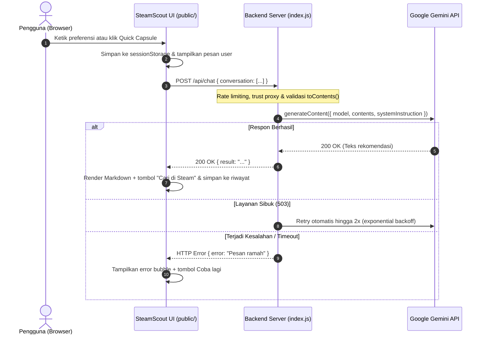

# SteamScout: Your Personal Game Curator

[](https://github.com/Farhanrhm/ChatBot/actions/workflows/ci.yml)
[](https://steamscout.netlify.app/)

SteamScout adalah aplikasi web chatbot rekomendasi game PC di ekosistem Steam. Menggunakan persona kurator game berbahasa Indonesia santai khas gamer, SteamScout membantu pemain menemukan 2-3 game yang relevan berdasarkan genre, spesifikasi perangkat (laptop kentang atau PC gaming), mode bermain (single-player atau co-op), budget, dan suasana hati.

---

## Antarmuka Aplikasi


---

## Fitur Utama

1. **Persona Kurator Steam Khusus**: Memberikan rekomendasi terstruktur (Judul, Genre/Tag, Alasan Cocok, Spek & Budget) dengan batas maksimal 2-3 game per balasan agar tidak membebani pengguna.
2. **Tombol "Cari di Steam" per Game**: Tautan instan pencarian toko resmi Steam (`https://store.steampowered.com/search/?term=...`) yang otomatis terpasang pada setiap judul game yang direkomendasikan.
3. **Memori Percakapan Bertingkat (Multi-turn)**: Mengingat konteks dan preferensi pengguna selama sesi obrolan berlangsung (misalnya: *"yang di bawah 100 ribu aja"* atau *"ada versi pixel art-nya?"*).
4. **Kartu dan Chip Saran Cepat (Quick Prompts)**: Tombol interaktif untuk memulai pencarian instan seperti Laptop kentang, Co-op santai, Menantang (Souls-like), dan Cozy.
5. **Desain Steam Dark Theme**: Palet warna autentik ekosistem Steam (`#171a21`, `#1b2838`, aksen cyan `#66c0f4`) dengan tipografi Barlow.
6. **Aksesibilitas Teruji (Lighthouse 100/100)**: Memenuhi standar aksesibilitas web dengan kontras warna teks (WCAG AA), ukuran target sentuh tombol minimal 44x44px, navigasi keyboard (`:focus-visible`), dan penamaan label ARIA yang selaras.
7. **Parser Markdown Aman**: Merender format tebal, miring, list, dan link dengan sanitasi HTML ketat untuk mencegah serangan XSS.
8. **Ketahanan Sesi (sessionStorage)**: Percakapan tidak hilang saat halaman dimuat ulang (refresh), dan dapat dikosongkan dengan tombol Reset chat.
9. **Indikator Responsif dan Penanganan Error**: Animasi typing indicator, penghitung karakter input (maksimal 1000 karakter), serta bubble error interaktif dengan tombol Coba lagi.
10. **Wishlist Lokal (Browser Storage)**: Simpan game favorit langsung dari kartu ke daftar pribadi pengguna (maksimal 50 game), dilengkapi tombol drawer di topbar, navigasi keyboard lengkap (`Esc`, focus trap), tombol "Salin daftar", dan ketahanan data saat chat di-reset.

---

## Teknologi yang Digunakan

- **Backend**: Node.js, Express.js (ES Modules)
- **AI SDK**: `@google/genai` (Google Gemini API, model `gemini-2.5-flash`)
- **Keamanan & Middleware**: `helmet`, `express-rate-limit`, `dotenv`
- **Frontend**: Vanilla HTML5, Vanilla CSS3 (CSS Variables, Flexbox, CSS Grid), Vanilla JavaScript (tanpa framework, tanpa build step)
- **Testing**: Node.js built-in test runner (`node:test`, `node:assert`)
- **CI/CD**: GitHub Actions (otomatisasi pengujian `npm test` pada branch `main`)

---

## Arsitektur & Kontrak API

### Diagram Alur Komunikasi



### Kontrak Endpoint API

#### 1. `POST /api/chat`
- **Request Headers**: `Content-Type: application/json`
- **Request Body**:
  ```json
  {
    "conversation": [
      { "role": "user", "text": "Game seru untuk laptop kentang" }
    ]
  }
  ```
- **Response Sukses (HTTP 200)**:
  ```json
  {
    "result": "Siap, laptop kentang bukan halangan buat dapat game seru!\n\n**Vampire Survivors** (2022, poncle)\n- **Genre & tag utama:** Roguelite, Action, Pixel Art\n- **Kenapa cocok:** Grafis 2D ringan tapi gameplay adiktif.\n- **Spek & budget:** Sangat ramah laptop kentang, di bawah Rp100 ribu.\n\nKamu lebih suka yang aksi cepat atau yang santai?"
  }
  ```
- **Response Error (HTTP 400 / 429 / 500 / 504)**:
  ```json
  {
    "error": "Pesan pengguna melebihi batas maksimal 1000 karakter."
  }
  ```

#### 2. `GET /api/health`
- **Response Sukses (HTTP 200)**:
  ```json
  {
    "status": "ok"
  }
  ```

---

## Struktur Direktori

```text
final_project/
├── .github/
│   └── workflows/
│       └── ci.yml            # Otomatisasi pengujian CI via GitHub Actions
├── .env.example              # Template variabel lingkungan
├── .gitignore                # Daftar pengecualian Git
├── AGENTS.md                 # Konfigurasi pointer antislop
├── index.js                  # Server Express, middleware keamanan & integrasi Gemini API
├── package.json              # Konfigurasi dependensi dan skrip proyek
├── package-lock.json
├── prompts/
│   └── systemPrompt.js       # Definisi terisolasi System Instruction SteamScout
├── public/                   # Frontend statis disajikan dari satu origin
│   ├── index.html            # Struktur antarmuka SteamScout
│   ├── script.js             # Logika interaktif, parser, dan manajemen sesi
│   └── style.css             # Tema Steam Dark dan tata letak responsif
├── test/
│   └── validation.test.js    # Unit testing validasi input toContents()
└── docs/
    ├── TEST_RESULTS.md       # Matriks 13 skenario pengujian kualitas & cURL
    ├── lighthouse-a11y.json  # Laporan hasil audit aksesibilitas Google Lighthouse (100/100)
    └── screenshots/          # Tangkapan layar antarmuka aplikasi
```

---

## Cara Instalasi & Menjalankan

### 1. Prasyarat
- Node.js versi 18.0.0 atau lebih tinggi.
- Kunci API Google Gemini (dapat diperoleh gratis di [Google AI Studio](https://aistudio.google.com/)).

### 2. Langkah Pemasangan
1. Kloning repositori dan masuk ke folder proyek:
   ```bash
   git clone https://github.com/Farhanrhm/ChatBot.git
   cd ChatBot
   ```
2. Pasang seluruh dependensi:
   ```bash
   npm install
   ```
3. Salin file konfigurasi lingkungan dari template:
   ```bash
   cp .env.example .env
   ```
4. Buka file `.env` dan masukkan API Key Gemini Anda:
   ```env
   GEMINI_API_KEY=AIzaSyContohApiKeyAnda
   ```
5. Jalankan server dalam mode pengembangan:
   ```bash
   npm run dev
   ```
6. Buka browser di alamat:
   ```text
   http://localhost:3000
   ```

---

## Live Demo

Aplikasi dapat diakses secara publik melalui tautan demo berikut:
👉 [https://steamscout.onrender.com](https://steamscout.onrender.com)

> [!NOTE]
> * **Cold Start pada Layanan Gratis**: Pada penyedia hosting cloud gratis (seperti Render Free Instance), server akan tidur (*sleep*) jika tidak ada lalu lintas. Permintaan pertama mungkin membutuhkan waktu 30-50 detik untuk merespons kembali.
> * **Batas Kuota Demo**: Untuk melindungi kuota Google AI Studio, demo publik dibatasi maksimal 500 permintaan per hari secara global dan 60 pesan per hari per IP.

---

## Panduan Deploy ke Cloud

Aplikasi SteamScout siap di-deploy langsung ke penyedia hosting cloud seperti **Render** atau **Railway**.

### 1. Deploy ke Render (Web Service)
1. Hubungkan repositori GitHub Anda ke akun Render.
2. Buat **New Web Service** dan pilih repositori `ChatBot`.
3. Atur konfigurasi build dan start:
   - **Environment**: `Node`
   - **Branch**: `main`
   - **Build Command**: `npm ci`
   - **Start Command**: `npm start`
   - **Health Check Path**: `/api/health`
4. Tambahkan **Environment Variables** di dashboard Render:
   - `GEMINI_API_KEY`: *(Kunci API Google Gemini Anda)*
   - `GEMINI_MODEL`: `gemini-2.5-flash`
   - `NODE_ENV`: `production`
   - `DAILY_REQUEST_CAP`: `500`
   - `DAILY_REQUEST_CAP_PER_IP`: `60`
5. Klik **Create Web Service**.

### 2. Deploy ke Railway
1. Buat **New Project** di Railway dan pilih **Deploy from GitHub repo**.
2. Buka tab **Settings** dan atur **Healthcheck Path** ke `/api/health`.
3. Buka tab **Variables** dan masukkan variabel lingkungan yang sama (`GEMINI_API_KEY`, `GEMINI_MODEL`, `NODE_ENV`, `DAILY_REQUEST_CAP`, `DAILY_REQUEST_CAP_PER_IP`).
4. Pada tab **Networking**, klik **Generate Domain** untuk mendapatkan URL publik HTTPS.

---

## Penjelasan Variabel Lingkungan (`.env`)

| Variabel | Deskripsi | Default |
|---|---|---|
| `GEMINI_API_KEY` | Kunci autentikasi Google Gemini API | *(Wajib diisi)* |
| `GEMINI_MODEL` | Nama model AI yang digunakan | `gemini-2.5-flash` |
| `GEMINI_TEMPERATURE` | Tingkat kreativitas variasi jawaban AI | `0.75` |
| `PORT` | Port server lokal Express | `3000` |
| `NODE_ENV` | Mode lingkungan aplikasi (`production` / `development`) | `development` |
| `RATE_LIMIT_WINDOW_MS` | Jendela waktu rate limit (dalam milidetik) | `60000` (1 menit) |
| `RATE_LIMIT_MAX` | Maksimal request yang diizinkan per menit per IP | `20` |
| `DAILY_REQUEST_CAP` | Batas maksimal total request demo per hari secara global | `500` |
| `DAILY_REQUEST_CAP_PER_IP` | Batas maksimal pesan demo per hari per alamat IP | `60` |

---

## Langkah Keamanan & Hardening

1. **Perlindungan Kredensial**: File `.env` masuk ke `.gitignore` sehingga API key tidak terunggah ke repositori publik. Server membatalkan proses startup jika API key belum dikonfigurasi saat mode produksi.
2. **Validasi Anti-Injeksi (`toContents`)**: Riwayat percakapan dari browser divalidasi ketat (maksimal 20 turn terakhir, membuang role selain `user` dan `model`, memangkas pesan user > 1000 karakter, dan menolak urutan ilegal).
3. **Pencegahan Denial of Service (DoS)**:
   - Pembatasan ukuran payload JSON dinaikkan ke batas aman `100kb` untuk mengakomodasi riwayat multi-turn hingga 20 turn tanpa memicu error 413.
   - Penerapan `express-rate-limit` (20 request per menit per IP) dan `trust proxy` untuk mencegah eksploitasi kuota API di lingkungan cloud hosting.
4. **Header Keamanan (Helmet)**: Menerapkan Content Security Policy (CSP) ketat yang hanya mengizinkan resource lokal serta Google Fonts resmi.
5. **Ketahanan Koneksi (Resilience)**: Panggilan Gemini dilengkapi batas timeout 30 detik serta mekanisme retry otomatis 2x dengan exponential backoff jika server Google mengalami status 503.
6. **Penyajian Single Origin**: Frontend disajikan langsung dari folder `./public/` oleh server Express sehingga tidak memerlukan konfigurasi CORS yang berisiko.
7. **Graceful Shutdown**: Server Express menangani sinyal `SIGINT` dan `SIGTERM` dengan batas waktu paksa 10 detik agar koneksi tertutup bersih saat proses dihentikan.

---

## Fitur Harga & Diskon Steam (Storefront Grounding)

SteamScout memverifikasi judul rekomendasi ke API publik Steam Storefront untuk menyajikan data harga dan status game secara langsung pada kartu:
1. **Model Status Tiga Keadaan**:
   * **Game Berbayar (`paid`)**: Menampilkan harga normal, serta harga awal yang dicoret dan badge diskon hijau (contoh: `-50%`) jika sedang berlangsung Steam Sale.
   * **Free to Play (`free`)**: Menampilkan label "Free to Play" hanya jika Steam mengonfirmasi status gratis (`is_free: true`).
   * **Segera Hadir (`upcoming`)**: Menampilkan label "Segera Hadir" untuk judul yang belum dirilis.
   * **Tidak Diketahui (`unknown`)**: Jika data harga tidak ada, kartu tetap tampil utuh tanpa baris harga (fallback anggun).
2. **Keandalan & Ketahanan (Resilience)**:
   * **Endpoint Tidak Resmi**: Data harga diambil dari endpoint publik Steam (`storesearch` dan `appdetails`). Endpoint ini tidak berdokumen resmi dan dapat membatasi laju permintaan sewaktu-waktu.
   * **Anggaran Waktu & Fallback**: Pengayaan Steam dibatasi total 6 detik dengan `Promise.allSettled`. Gangguan koneksi atau timeout Steam tidak akan pernah menggagalkan balasan kurasi Gemini.
   * **Pencocokan Judul & Penolakan Sekuel**: Sistem membedakan judul dengan nomor sekuel berbeda (seperti *Hades* vs *Hades II* atau *Portal* vs *Portal 2*), menolak DLC/soundtrack, dan menormalisasi aksen Unicode.
   * **Caching Cerdas**: Data harga di-cache selama 10 menit (dan 1 menit untuk status unknown) dengan batas maksimal 200 entri untuk mencegah beban berlebih ke server Steam.

---

## Keterbatasan Sistem

- **Akurasi AI**: Rekomendasi dihasilkan oleh LLM dan dapat sewaktu-waktu mengalami ketidakakuratan data mengenai detail tahun rilis atau developer game indie tertentu.
- **Dinamika Harga Toko Steam**: Informasi harga game, event diskon (Steam Sale), dan status Early Access dapat berubah sewaktu-waktu. Harga di aplikasi merupakan hasil pengecekan saat permintaan diproses dan dapat berbeda dari halaman toko langsung. Pengguna disarankan untuk memeriksa halaman toko resmi Steam sebelum membeli game.
- **Penyimpanan Wishlist Lokal di Browser**: Data wishlist disimpan di `localStorage` peramban web pengguna dan tidak terhubung ke akun Steam pribadi atau server cloud. Daftar wishlist akan hilang jika pengguna menghapus riwayat/data situs browser atau menggunakan mode penjelajahan pribadi (Incognito).
- **Waktu Bangun Hosting Gratis (Cold Start)**: Jika di-deploy pada layanan cloud gratis yang menerapkan penonaktifan sementara saat tidak ada lalu lintas, permintaan pertama mungkin membutuhkan waktu beberapa detik lebih lama untuk merespons.

---

## Rencana Pengembangan Selanjutnya

- [x] **Tombol "Cari di Steam" per Game**: Tautan pencarian langsung ke toko resmi Steam per rekomendasi game.
- [x] **Structured JSON Output (Response Schema)**: Objek data terstruktur (`intro`, `games`, `followUp`) yang dirender ke dalam kartu game interaktif.
- [x] **Verifikasi Storefront Steam / Grounding**: Cek judul game ke Steam Storefront API untuk menampilkan cover art resmi dan link halaman resmi.
- [x] **Real-time Streaming (SSE)**: Mengirim balasan respon melalui Server-Sent Events (`/api/chat/stream`) agar proses pembuatan rekomendasi responsif.
- [x] **Informasi Harga & Deteksi Diskon Steam Sale**: Menampilkan badge diskon hijau, harga asli dicoret, status Free to Play, dan Segera Hadir.
- [x] **Opsi B: Fitur Wishlist & Backlog Lokal**: Menyimpan game rekomendasi favorit ke penyimpanan lokal browser (`localStorage`) dan mengekspor daftar game.
- [ ] **Opsi C: Quick Preference Filter Bar**: Preset toggle cepat di atas area input (misal: "Laptop Kentang", "Di Bawah Rp100k", "Co-op / Mabar").

---

## Disclaimer

Proyek ini dibuat untuk tujuan edukasi dan portofolio. Aplikasi ini **tidak berafiliasi, disponsori, atau didukung secara resmi oleh Valve Corporation maupun platform Steam**. Semua nama game, merek dagang, dan materi berhak cipta merupakan milik pemiliknya masing-masing.

