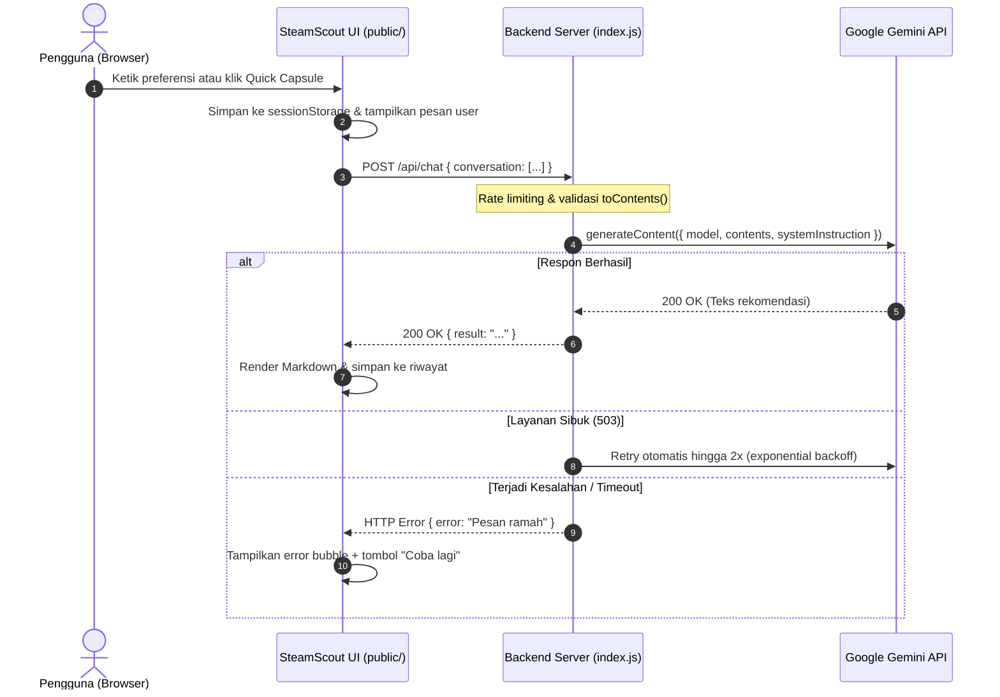

# 🎮 SteamScout: Your Personal Game Curator

SteamScout adalah asisten chatbot cerdas berbasis AI yang dirancang khusus untuk merekomendasikan game PC di platform Steam. Menggunakan persona kurator game yang ramah, antusias, dan berbahasa Indonesia santai khas gamer, SteamScout membantu pemain menemukan 2–3 game terbaik sesuai genre, spesifikasi perangkat (laptop kentang vs PC gaming), mode bermain (single-player vs co-op), budget, dan suasana hati.

---

## 📸 Antarmuka Aplikasi

> *Tangkapan layar antarmuka SteamScout dapat ditempatkan pada direktori [./docs/screenshots/](./docs/screenshots/)*

| Tampilan Desktop | Tampilan Mobile |
|:---:|:---:|
|  *(Placeholder)* |  *(Placeholder)* |

---

## ✨ Fitur Utama

1. **Persona Kurator Steam Khusus**: Memberikan rekomendasi terstruktur (Judul, Genre/Tag, Alasan Cocok, Spek & Budget) dengan batas maksimal 2–3 game per balasan agar tidak membebani pengguna.
2. **Memori Percakapan Bertingkat (Multi-turn)**: Mengingat preferensi pengguna selama sesi obrolan berlangsung (misalnya: *"yang di bawah 100 ribu aja"* atau *"ada versi pixel art-nya?"*).
3. **Kartu & Chip Saran Cepat (Quick Prompts)**: Tombol interaktif untuk memulai pencarian instan seperti *"Laptop kentang"*, *"Co-op santai"*, *"Menantang (Souls-like)"*, dan *"Cozy"*.
4. **Desain Khas Steam Dark Theme**: Palet warna autentik ekosistem Steam (`#171a21`, `#1b2838`, aksen cyan `#66c0f4`) dengan font *Barlow*.
5. **Parser Markdown Aman**: Merender format tebal, miring, list, dan link dengan sanitasi HTML ketat untuk mencegah serangan XSS.
6. **Ketahanan Sesi (sessionStorage)**: Percakapan tidak hilang saat halaman di-refresh, dan dapat dibersihkan dengan tombol *"Reset chat"*.
7. **Indikator Responsif & Penanganan Error**: Animasi *typing indicator*, penghitung karakter input (maks 1000), serta bubble error interaktif dengan tombol *"Coba lagi"*.

---

## 🛠️ Teknologi yang Digunakan

- **Backend**: Node.js, Express.js (ES Modules)
- **AI SDK**: `@google/genai` (Google Gemini API)
- **Keamanan & Middleware**: `helmet`, `express-rate-limit`, `dotenv`
- **Frontend**: Vanilla HTML5, Vanilla CSS3 (CSS Variables, Flexbox, CSS Grid), Vanilla JavaScript (tanpa framework, tanpa build step)
- **Testing**: Node.js built-in test runner (`node:test`, `node:assert`)

---

## 🏗️ Arsitektur & Kontrak API

### Diagram Alur Komunikasi



### Kontrak Endpoint API

#### 1. `POST /api/chat`
- **Request Headers**: `Content-Type: application/json`
- **Request Body**:
  ```json
  {
    "conversation": [
      { "role": "user", "text": "Game seru untuk laptop kentang" }
    ]
  }
  ```
- **Response Sukses (HTTP 200)**:
  ```json
  {
    "result": "Siap, laptop kentang bukan halangan buat dapat game seru! 🎮\n\n**Vampire Survivors** (2022, poncle)\n- **Genre & tag utama:** Roguelite, Action, Pixel Art\n- **Kenapa cocok:** Grafis 2D ringan tapi gameplay adiktif.\n- **Spek & budget:** Sangat ramah laptop kentang, di bawah Rp100 ribu.\n\nKamu lebih suka yang aksi cepat atau yang santai?"
  }
  ```
- **Response Error (HTTP 400 / 429 / 500 / 504)**:
  ```json
  {
    "error": "Pesan pengguna melebihi batas maksimal 1000 karakter."
  }
  ```

#### 2. `GET /api/health`
- **Response Sukses (HTTP 200)**:
  ```json
  {
    "status": "ok"
  }
  ```

---

## 📁 Struktur Direktori

```text
final_project/
├── .env.example              # Template variabel lingkungan
├── .gitignore                # Daftar pengecualian Git (melindungi file rahasia)
├── AGENTS.md                 # Konfigurasi pointer skill antislop
├── index.js                  # Entry point server Express & integrasi Gemini API
├── package.json              # Konfigurasi dependensi dan skrip proyek
├── package-lock.json
├── prompts/
│   └── systemPrompt.js       # Definisi terisolasi System Instruction SteamScout
├── public/                   # Frontend statis disajikan dari satu origin
│   ├── index.html            # Struktur antarmuka SteamScout
│   ├── script.js             # Logika interaktif, sanitasi, dan manajemen sesi
│   └── style.css             # Tema Steam Dark dan tata letak responsif
├── test/
│   └── validation.test.js    # Unit testing validasi input toContents()
└── docs/
    ├── TEST_RESULTS.md       # Matriks skenario pengujian kualitas & cURL
    └── screenshots/          # Folder aset tangkapan layar antarmuka
```

---

## 🚀 Cara Instalasi & Menjalankan

### 1. Prasyarat
- Node.js versi 18.0.0 atau lebih tinggi.
- Kunci API Google Gemini (dapat diperoleh gratis di [Google AI Studio](https://aistudio.google.com/)).

### 2. Langkah Pemasangan
1. Kloning repositori dan masuk ke folder proyek:
   ```bash
   git clone https://github.com/Farhanrhm/ChatBot.git
   cd ChatBot
   ```
2. Pasang seluruh dependensi:
   ```bash
   npm install
   ```
3. Salin file konfigurasi lingkungan dari template:
   ```bash
   cp .env.example .env
   ```
4. Buka file `.env` dan masukkan API Key Gemini Anda:
   ```env
   GEMINI_API_KEY=AIzaSyContohApiKeyAnda
   ```
5. Jalankan server dalam mode pengembangan:
   ```bash
   npm run dev
   ```
6. Buka browser Anda di alamat:
   ```text
   http://localhost:3000
   ```

---

## ⚙️ Penjelasan Variabel Lingkungan (`.env`)

| Variabel | Deskripsi | Default |
|---|---|---|
| `GEMINI_API_KEY` | Kunci autentikasi Google Gemini API | *(Wajib diisi)* |
| `GEMINI_MODEL` | Nama model AI yang digunakan | `gemini-2.0-flash` |
| `GEMINI_TEMPERATURE` | Tingkat kreativitas variasi jawaban AI | `0.75` |
| `PORT` | Port server lokal Express | `3000` |
| `NODE_ENV` | Mode lingkungan aplikasi | `development` |
| `RATE_LIMIT_WINDOW_MS` | Jendela waktu rate limit (dalam milidetik) | `60000` (1 menit) |
| `RATE_LIMIT_MAX` | Maksimal request yang diizinkan per IP | `20` |

---

## 🔒 Langkah Keamanan & Hardening

1. **Perlindungan Kredensial**: File `.env` masuk ke `.gitignore` sehingga API key tidak pernah terunggah ke repositori publik. Server membatalkan proses startup jika API key belum dikonfigurasi.
2. **Validasi Anti-Injeksi (`toContents`)**: Riwayat percakapan dari browser divalidasi ketat (maksimal 20 turn terakhir, membuang role selain `user` dan `model`, memangkas pesan user > 1000 karakter, dan menolak urutan ilegal).
3. **Pencegahan Denial of Service (DoS)**:
   - Pembatasan ukuran payload JSON dibatasi maksimum `10kb`.
   - Penerapan `express-rate-limit` (20 request/menit per IP) untuk mencegah eksploitasi kuota API.
4. **Header Keamanan (Helmet)**: Menerapkan Content Security Policy (CSP) ketat yang hanya mengizinkan resource lokal serta Google Fonts resmi.
5. **Ketahanan Koneksi (Resilience)**: Panggilan Gemini dilengkapi batas *timeout* 30 detik serta mekanisme *retry otomatis 2x* dengan *exponential backoff* jika server Google mengalami status 503.
6. **Penyajian Single Origin**: Frontend disajikan langsung dari folder `./public/` oleh server Express sehingga tidak memerlukan konfigurasi CORS yang berisiko.

---

## ⚠️ Keterbatasan Sistem

- **Akurasi AI**: Rekomendasi dihasilkan oleh LLM dan dapat sewaktu-waktu mengalami ketidakakuratan data kecil mengenai detail tahun rilis atau developer game indie.
- **Dinamika Toko Steam**: Informasi harga game, event diskon (Steam Sale), dan status Early Access dapat berubah sewaktu-waktu. Pengguna selalu disarankan untuk memeriksa halaman toko resmi Steam sebelum membeli game.

---

## 🔮 Rencana Pengembangan Selanjutnya (Fase 3)

- [ ] **Structured JSON Output**: Memanfaatkan `responseSchema` Gemini agar menghasilkan data terstruktur (nama, banner, rating) yang dapat langsung dirender menjadi kartu game visual interaktif.
- [ ] **Verifikasi Storefront Steam**: Integrasi dengan API publik Steam Storefront untuk menarik thumbnail resmi game, harga terkini, dan status review *"Overwhelmingly Positive"*.
- [ ] **Server-Sent Events (SSE) Streaming**: Menampilkan teks balasan Gemini secara bertahap (*typing effect*) secara real-time.

---

## ⚖️ Disclaimer

Proyek ini dibuat untuk tujuan edukasi dan portofolio. Aplikasi ini **tidak berafiliasi, disponsori, atau didukung secara resmi oleh Valve Corporation maupun platform Steam**. Semua nama game, merek dagang, dan materi berhak cipta merupakan milik pemiliknya masing-masing.
